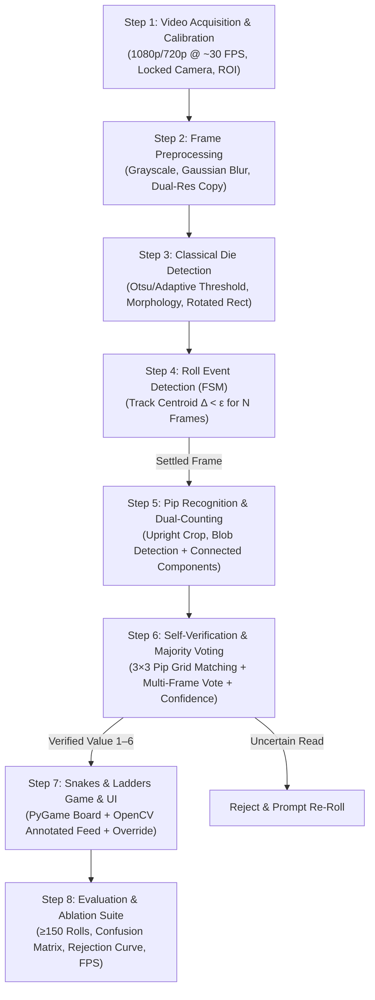
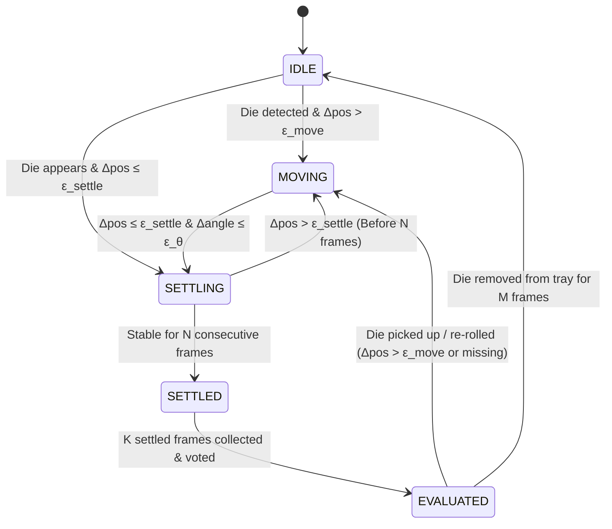

# 1. Implementation Plan

**Project Title:** Self-Verifying Real-Time Dice Recognition Using Blob Detection and Morphology for a Computer Vision-Driven Snakes and Ladders Game

This document separates the implementation of the system into **8 sequential, testable steps (phases)**. Each step defines its objective, inputs and outputs, algorithmic details, target modules, and verification criteria so the pipeline can be built and validated incrementally.

---

## High-Level Pipeline Architecture

---

## Step 1: Environment Setup, Video Acquisition & Play-Area Calibration

### Objective
Establish the Python environment, project directory structure, and a unified video acquisition module that supports both a live USB smartphone webcam (at $1920 \times 1080$ or $1280 \times 720$, ~30 FPS) and pre-recorded video clips for deterministic testing and evaluation.

### Key Tasks
1. **Project Scaffolding & Dependencies:**
   - Set up `requirements.txt` (`opencv-python`, `numpy`, `pygame`, `matplotlib`, `pandas`, `pytest`).
   - Create modular package layout (`src/acquisition`, `src/vision`, `src/game`, `src/ui`, `src/evaluation`).
2. **Camera & Video Stream Wrapper (`src/acquisition/camera.py`):**
   - Implement `VideoStream` class supporting live device index (e.g., DroidCam / Iriun / V4L2 USB webcam) and video file paths (`.mp4`, `.avi`).
   - Enforce resolution negotiation ($1920 \times 1080$ preferred, fallback $1280 \times 720$) and target 30 FPS.
   - Attempt programmatic lock of auto-exposure, autofocus, and auto-white-balance via OpenCV `CAP_PROP_*` properties, coupled with a calibration check HUD.
3. **Play-Area Region of Interest (ROI) & Recording Utility (`src/acquisition/recorder.py`):**
   - Configurable static rectangular ROI (`roi_x, roi_y, roi_w, roi_h`) isolating the dark matte rolling tray.
   - Built-in raw video recorder to save live roll sessions with frame timestamps for offline evaluation and tuning of $N$ (settle frame count).

### Deliverable Criterion
- Running the acquisition script displays a live or recorded feed at $\ge 25\text{ FPS}$ with an overlaid ROI boundary and saves clean 720p/1080p test clips to `data/recordings/`.

---

## Step 2: Dual-Resolution Preprocessing Module

### Objective
Prepare each incoming frame for fast coarse die localization while preserving crisp high-resolution pixel data for small pip extraction on a 16 mm physical die.

### Key Tasks
1. **ROI Cropping & Color Conversion (`src/vision/preprocessing.py`):**
   - Crop incoming full-resolution frame $I_{\text{full}}$ to the play-area ROI.
   - Convert the ROI to single-channel 8-bit grayscale $I_{\text{gray}}$.
2. **Dual-Stream Generation:**
   - **Detection Stream (Downscaled):** Resize $I_{\text{gray}}$ by scale factor $s = 0.5$ (e.g., $960 \times 540$ from $1920 \times 1080$) and apply a $5 \times 5$ Gaussian blur ($\sigma = 1.2$) to suppress sensor grain and matte surface texture.
   - **Recognition Stream (Full-Resolution):** Retain the unscaled grayscale ROI $I_{\text{gray}}$ with a light $3 \times 3$ Gaussian blur ($\sigma = 0.8$) so individual pips (typically 6–15 pixels in diameter) retain sharp edges.

### Deliverable Criterion
- Unit benchmark confirms preprocessing takes $< 2\text{ ms}$ per frame on the development laptop and outputs aligned coordinate scaling factors between the downscaled and full-resolution frames.

---

## Step 3: Classical Die Detection & Upright Warping

### Objective
Segment the white die against the dark matte background, reject non-die distractors or multi-die ambiguities, and extract a perspective-corrected, upright crop of the top die face.

### Key Tasks
1. **Brightness Segmentation (`src/vision/die_detector.py`):**
   - Apply Otsu's global thresholding (`cv2.THRESH_BINARY | cv2.THRESH_OTSU`) or local Gaussian adaptive thresholding (`cv2.adaptiveThreshold`) on the downscaled grayscale image to isolate the bright die body.
2. **Morphological Mask Cleaning:**
   - Apply **Morphological Closing** ($5 \times 5$ elliptical structuring element) to bridge dark pips near the edges of the die face so the die forms a single solid contour.
   - Apply **Morphological Opening** ($3 \times 3$ structuring element) to eliminate small specular dust or lint specks on the dark surface.
3. **Contour Filtering & Single-Die Enforcement:**
   - Extract external contours (`cv2.findContours` with `RETR_EXTERNAL`).
   - Filter candidate contours by:
     - **Area range:** $A_{\min} \le A \le A_{\max}$ (calibrated to a 16 mm die at camera working distance).
     - **Squareness / Aspect Ratio:** Fit a minimum-area rotated bounding rectangle (`cv2.minAreaRect`) with width $w$ and height $h$, requiring $\frac{\min(w, h)}{\max(w, h)} \ge 0.75$.
     - **Solidity / Rectangularity:** $\frac{A}{w \cdot h} \ge 0.78$.
   - **Ambiguity Guard:** If $0$ valid contours or $>1$ valid contours are detected (e.g., player's hand/fingers in the tray), mark the frame as `NO_VALID_DIE` and skip pip recognition.
4. **Full-Resolution Upright Die Face Extraction:**
   - Map the rotated rectangle center $(c_x, c_y)$, dimensions $(w, h)$, and angle $\theta$ back to full-resolution coordinates ($\times \frac{1}{s}$).
   - Compute an affine/perspective warp (`cv2.getRotationMatrix2D` / `cv2.warpPerspective`) to crop and normalize the die face into a standardized $120 \times 120\text{ px}$ upright square patch $I_{\text{face}}$, applying a small inward margin (e.g., $8\%$) to trim side-face bevel artifacts.

### Deliverable Criterion
- Given static frames of a 16 mm die at arbitrary $0^\circ\text{–}360^\circ$ planar rotations, the detector outputs a tightly cropped, upright $120 \times 120$ die face image and rejects frames containing hands or empty trays.

---

## Step 4: Roll Event Detection (Temporal State Machine)

### Objective
Track the die's trajectory across consecutive frames to determine the exact moment a physical throw settles, ensuring a moving die is never read and each physical throw triggers exactly one read event.

### State Machine Design (`src/vision/roll_tracker.py`)

### Key Tasks
1. **Motion Metric Calculation:**
   - Between frame $t-1$ and frame $t$, compute centroid Euclidean displacement:
     $$\Delta d_t = \sqrt{(c_{x,t} - c_{x,t-1})^2 + (c_{y,t} - c_{y,t-1})^2}$$
   - Compute bounding-box area stability $\frac{|A_t - A_{t-1}|}{A_{t-1}}$.
2. **Settle Condition ($N$ Consecutive Frames):**
   - Declare `SETTLED` only when $\Delta d_t < \epsilon_{\text{settle}}$ (e.g., $2.0\text{ px}$ in full-res) for $N$ consecutive frames ($N \approx 8\text{–}12\text{ frames}$, empirically tuned from recorded rolls).
3. **Read Window & Reset Latch:**
   - Once `SETTLED`, collect $K$ settled frames (e.g., $K = 10\text{–}15\text{ frames}$) for pip recognition and majority voting.
   - Latch into `EVALUATED` state after emitting a roll result (or uncertain rejection) so the stationary die does not repeatedly trigger turns.
   - Unlock only when the die moves again ($\Delta d_t > \epsilon_{\text{move}}$) or leaves the ROI during pickup.

### Deliverable Criterion
- Tested against recorded roll videos, the tracker logs zero premature reads during bouncing/sliding and transitions cleanly once per throw.

---

## Step 5: Pip Segmentation & Dual-Method Counting

### Objective
Extract dark pips from the upright $120 \times 120$ die face patch and count them independently using both `SimpleBlobDetector` and Connected-Component Analysis (CCA).

### Key Tasks
1. **Pip Mask Segmentation (`src/vision/pip_detector.py`):**
   - Invert-threshold the upright face patch $I_{\text{face}}$ using Otsu's threshold or local contrast threshold (`cv2.THRESH_BINARY_INV | cv2.THRESH_OTSU`) so dark pips become white foreground objects on a black background.
   - Clear border-touching artifacts (flood-fill or border mask margin) caused by die edge shadows.
   - Apply **Morphological Opening** ($3 \times 3$ circular kernel) to remove specular micro-noise, followed by **Morphological Closing** ($3 \times 3$) to fill specular highlights inside shiny pips.
2. **Method A — `cv2.SimpleBlobDetector`:**
   - Configure `SimpleBlobDetector_Params` on the cleaned face image:
     - `filterByColor = True` (`blobColor = 0` on grayscale or `255` on binary mask)
     - `filterByArea = True` ($A_{\text{pip},\min} \le A \le A_{\text{pip},\max}$, scaled to the $120 \times 120$ patch)
     - `filterByCircularity = True` ($\text{circularity} = \frac{4\pi A}{P^2} \ge 0.65$)
     - `filterByConvexity = True` ($\ge 0.80$)
     - `filterByInertia = True` ($\ge 0.50$)
   - Output count $C_{\text{blob}}$ and list of keypoint centers $\{(x_i, y_i)\}_{i=1}^{C_{\text{blob}}}$.
3. **Method B — Connected-Component Analysis (`cv2.connectedComponentsWithStats`):**
   - Run 8-connectivity labeling on the binary pip mask.
   - Filter components by area $[A_{\text{pip},\min}, A_{\text{pip},\max}]$, bounding-box aspect ratio $[0.65, 1.45]$, and circularity derived from contour perimeter.
   - Output count $C_{\text{cc}}$ and component centroids $\{(x_j, y_j)\}_{j=1}^{C_{\text{cc}}}$.
4. **Dual-Count Cross-Check:**
   - Flag single-frame agreement $M_{\text{count}} = (C_{\text{blob}} == C_{\text{cc}}) \land (1 \le C_{\text{blob}} \le 6)$.

### Deliverable Criterion
- Independent outputs from `SimpleBlobDetector`, `connectedComponentsWithStats`, and their combined agreement flag are available for both live verification and ablation comparisons.

---

## Step 6: Geometric $3 \times 3$ Pip Layout Verification & Multi-Frame Majority Voting

### Objective
Enforce geometric self-verification by mapping detected pip coordinates onto a canonical $3 \times 3$ die grid and aggregating verified reads across all settled frames via majority voting.

### Canonical $3 \times 3$ Die Face Templates
A standard Western die face partitions into 9 grid cells $(r, c) \in \{0, 1, 2\} \times \{0, 1, 2\}$. Accounting for $90^\circ$ planar rotation symmetries of the square crop, there are **9 valid binary $3 \times 3$ occupancy matrices** across the 6 die values:

| Die Value | Canonical $3 \times 3$ Grid Pattern(s) (Occupied Cells) | Rotational Variants |
| :--- | :--- | :---: |
| **1** | Center only: $\{(1,1)\}$ | 1 |
| **2** | Main diagonal $\{(0,0), (2,2)\}$ OR Anti-diagonal $\{(0,2), (2,0)\}$ | 2 |
| **3** | Main diagonal $\{(0,0), (1,1), (2,2)\}$ OR Anti-diagonal $\{(0,2), (1,1), (2,0)\}$ | 2 |
| **4** | Four corners: $\{(0,0), (0,2), (2,0), (2,2)\}$ | 1 |
| **5** | Four corners + center: $\{(0,0), (0,2), (1,1), (2,0), (2,2)\}$ | 1 |
| **6** | Two columns $\{(0,0),(1,0),(2,0),(0,2),(1,2),(2,2)\}$ OR Two rows $\{(0,0),(0,1),(0,2),(2,0),(2,1),(2,2)\}$ | 2 |

### Key Tasks
1. **$3 \times 3$ Grid Mapping (`src/vision/verifier.py`):**
   - Normalize each detected pip centroid $(x_i, y_i)$ within the inner pip-bounding region of the $120 \times 120$ upright face to grid indices:
     $$r_i = \lfloor 3 \cdot \hat{y}_i \rfloor, \quad c_i = \lfloor 3 \cdot \hat{x}_i \rfloor \quad \in \{0, 1, 2\}$$
   - Construct the $3 \times 3$ occupancy matrix $G$. If two pips fall into the same cell (collision) or $G$ does not exactly match one of the 9 valid templates, mark the frame's layout check as `INVALID_LAYOUT`.
2. **Multi-Frame Majority Voting & Confidence Score:**
   - Over the $K$ settled frames of a roll event, each frame $k \in \{1, \dots, K\}$ produces a frame verdict $v_k \in \{1, 2, 3, 4, 5, 6, \text{UNCERTAIN}\}$.
   - Compute the modal valid value $v^*$ and its support ratio:
     $$\text{Confidence} = \frac{1}{K} \sum_{k=1}^{K} \mathbb{I}(v_k == v^*)$$
   - **Acceptance Rule:** Accept $v^*$ if and only if $\text{Confidence} \ge \tau_{\text{conf}}$ (e.g., $\tau_{\text{conf}} = 0.70$), where each supporting frame passed dual-count agreement ($C_{\text{blob}} == C_{\text{cc}}$) and the $3 \times 3$ layout check.
   - Otherwise, emit `UNCERTAIN` (rejected read) and prompt the player to re-roll.

### Deliverable Criterion
- Synthetic and real test cases with glare specks (e.g., 4 pips + 1 random glare spot in cell $(0,1)$) or partial occlusion are deterministically rejected as `UNCERTAIN` rather than misclassified as a 5.

---

## Step 7: Minimal Snakes and Ladders Game Engine & Unified GUI

### Objective
Connect the verified dice reader to a crisp, ~150-line Snakes and Ladders game engine and render both the annotated live camera view and the interactive digital board in real time.

### Key Tasks
1. **Snakes and Ladders Core Logic (`src/game/board.py`, ~150 lines):**
   - $10 \times 10$ Boustrophedon (serpentine) board numbered $1$ to $100$.
   - Standard dictionary of **Ladders** (climb up: e.g., $4 \to 14, 9 \to 31, 20 \to 38, 28 \to 84, 40 \to 59, 51 \to 67, 63 \to 81, 71 \to 91$) and **Snakes** (slide down: e.g., $17 \to 7, 54 \to 34, 62 \to 19, 64 \to 60, 87 \to 24, 93 \to 73, 95 \to 75, 99 \to 78$).
   - Turn rules:
     - Advance current player token by recognized value $v^* \in \{1..6\}$.
     - Apply ladder climb or snake slide if landing on a trigger square.
     - **Bonus Roll Rule:** Rolling a $6$ grants an immediate extra turn.
     - Exact-100 bounce/hold win condition.
2. **Dual-View Visualization & Controls (`src/ui/app.py`):**
   - **Camera HUD Panel (OpenCV → PyGame surface):**
     - Rotated bounding box around the die (color-coded: Yellow = Moving, Cyan = Settling, Green = Verified, Red = Uncertain/Rejected).
     - Inset visualization of the upright $120 \times 120$ cropped face, detected blobs, and $3 \times 3$ grid overlay.
     - Status banner: e.g., `"Die: 5 (Conf: 93%) -> Player 1 moves 5"` or `"Uncertain Read -> Please Re-Roll"`, plus real-time FPS counter.
   - **Game Board Panel (PyGame):**
     - $10 \times 10$ grid with visual snakes and ladders, animated player tokens, turn indicator, and roll history log.
   - **Manual Override Keys:**
     - Keys `1`–`6` to manually override/correct a roll if needed, `U` to undo the last move, `R` to reset the game, and `SPACE` to pause/resume camera reading.

### Deliverable Criterion
- End-to-end application runs at $\ge 15\text{ FPS}$ (target $25\text{–}30\text{ FPS}$) on the laptop, automatically moving tokens on verified physical rolls and prompting re-rolls on uncertain reads.

---

## Step 8: Comprehensive Evaluation & Ablation Suite

### Objective
Quantitatively evaluate the system against all project targets across $\ge 150$ physical rolls, perform the required ablation studies, and generate publication-ready plots and error analyses.

### Key Tasks
1. **Ground-Truth Roll Dataset Collection (`data/eval_rolls/`):**
   - Record at least **150 physical rolls** (balanced across faces 1–6, varied landing positions within the ROI, and controlled vs. challenging lighting levels) with hand-recorded ground-truth labels (`ground_truth.csv`).
2. **Automated Benchmark Runner (`src/evaluation/benchmark.py`):**
   - Replay recorded roll sequences through configurable pipeline flags:
     - `use_blob_detector: bool`
     - `use_cc_detector: bool`
     - `use_grid_check: bool`
     - `use_majority_vote: bool` (vs. single first-settled-frame read)
     - Confidence threshold $\tau_{\text{conf}} \in [0.0, 1.0]$
3. **Metrics & Plots Generator (`src/evaluation/plots.py`):**
   - **Pip Read Accuracy & Rejection Rate:** Accuracy on accepted rolls vs. fraction of rolls rejected as uncertain ($\text{target} \ge 95\%$ accuracy).
   - **Accuracy–Rejection Curve:** Plot accuracy as a function of rejection rate by sweeping $\tau_{\text{conf}}$ and verification gates.
   - **Confusion Matrix:** $6 \times 6$ confusion matrix (+ `Rejected` column) across all ground-truth faces.
   - **Ablation Comparison Table:**
     1. Full Pipeline (Blob + CC + $3 \times 3$ Grid + Majority Vote)
     2. Without $3 \times 3$ Pip Layout Check
     3. Without Majority Voting (Single-Frame Read)
     4. Blob Detection Alone vs. Connected Components Alone
   - **Roll Event Detection Metrics:** Premature read rate (reading while still moving) and missed settle rate (failing to detect a stopped die).
   - **Runtime Throughput:** Mean, median, and 5th-percentile FPS across the full loop ($\text{target} \ge 15\text{ FPS}$).
   - **Failure Mode Gallery:** Automatically export annotated crops of any misclassified or rejected frames categorized by root cause (glare, motion blur, shadow border, severe tilt).

### Deliverable Criterion
- Running `python -m src.evaluation.benchmark` reproduces all evaluation tables, confusion matrices, accuracy-rejection curves, and FPS benchmarks in `reports/`.
